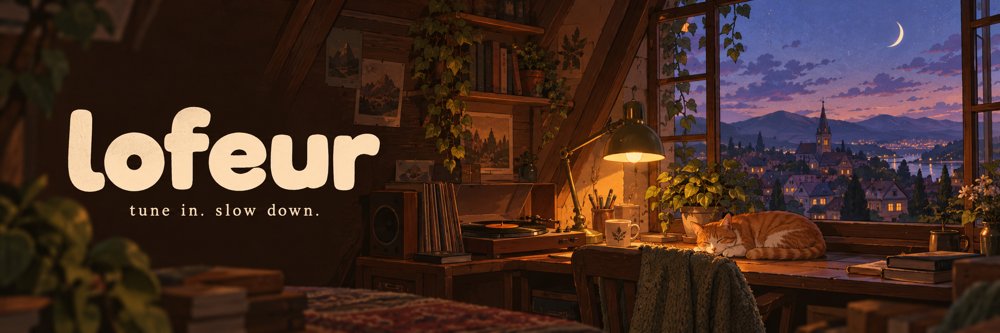

<p align="center">
  
</p>

<p align="center">
  
</p>

<h1 align="center">Your little corner of calm.</h1>

<p align="center">
  Lofi radio. Rain at the window. One thing at a time.<br />
  A personal lofi desk with editable YouTube stations, ambient soundscapes and a focus timer.
</p>

<p align="center">
  <a href="https://github.com/jean-voila/lofeur/actions/workflows/ci.yml"></a>
  
  
  
  <a href="LICENSE"></a>
</p>

<p align="center">
  <a href="#a-desk-that-gets-out-of-your-way">Features</a> ·
  <a href="#make-yourself-at-home">Get started</a> ·
  <a href="#your-stations-your-rules">Custom stations</a> ·
  <a href="CONTRIBUTING.md">Contribute</a>
</p>

---

## A desk that gets out of your way

Inspired by [Lofi Desk](https://desk.lofigirl.com/), rebuilt around listening and
concentration. The familiar study scene and translucent controls, without account
gates, live chat, shopping widgets, announcements, notes or to-do lists.

| Tune in                                                          | Set the mood                                           | Find your rhythm                                          |
| ---------------------------------------------------------------- | ------------------------------------------------------ | --------------------------------------------------------- |
| **18 public Lofi Girl stations**, available from the first visit | **12 original soundscapes**, mixed independently       | **Classic & long Pomodoro** with short and long breaks    |
| Add, edit and remove your own YouTube links                      | Rain, beach, forest, fireplace, café, purring and more | Eight phases, pause, reset and adjustable alarm volume    |
| Favorites, search, previous / next and volume controls           | Favorites, individual levels and a master volume       | Day / night theme, fullscreen and a hidden-interface view |

All preferences live in your browser. No API key, account, backend or analytics
service is required. The interface is in French.

## A little look inside

<p align="center">
  
</p>

<details>
<summary>Browse and edit your stations</summary>
<p align="center">
  
</p>
</details>

<details>
<summary>Made for small screens, too</summary>
<p align="center">
  
</p>
</details>

## Make yourself at home

**Node.js 22.12+ or 24+** and npm are all you need.

```bash
git clone https://github.com/jean-voila/lofeur.git
cd lofeur
npm ci
npm run dev
```

Open **http://127.0.0.1:5173** and press **Entrer dans ma bulle**. YouTube loads
only after this action. Ambient sounds can be used independently.

```bash
npm test           # URL validation, station imports and timer recovery
npm run build      # TypeScript checks + production build
npm run preview    # Serve the production build locally
```

To self-host, serve the generated `dist/` directory at the root of any static
HTTPS host. There is no server to configure. Music and artwork require an internet
connection; this is not an offline music player.

## Your stations, your rules

Open **Stations → +** to add a frequency. Set a name and paste a YouTube video or
live link. Descriptions and custom HTTPS cover images are optional. Use the pencil
icon to change or remove a station. At least one station is always kept.

Supported links include `youtube.com/watch?v=…`, `youtube.com/live/…`,
`youtu.be/…`, `youtube.com/embed/…` and plain 11-character video IDs.

**Exporter / Importer** transfers your station list as JSON. Import replaces the
current list; export a backup first if you want to keep it. Imports are validated,
limited to 100 entries and reject duplicate IDs. Use the reset button to restore
the original catalog.

```json
[
  {
    "id": "my-radio",
    "name": "Sunday radio",
    "url": "https://www.youtube.com/watch?v=rFZHOHl-L8A",
    "description": "A slower start to the day",
    "cover": ""
  }
]
```

Default stations live in [`src/stations.json`](src/stations.json). YouTube streams
can move or restrict embedding; change the URL or use the external YouTube link
when that happens. Only public station IDs from the reference catalog are included.

## A few quiet shortcuts

| Key      | Action                                          |
| -------- | ----------------------------------------------- |
| `Space`  | Play / pause radio                              |
| `F`      | Fullscreen                                      |
| `H`      | Hide / show interface                           |
| `M`      | Mute / unmute radio                             |
| `Escape` | Close panels or leave the hidden-interface view |

Shortcuts stay out of the way while typing or editing a station.

## Under the hood

**React 19 · TypeScript · Vite · Lucide · Vitest**

```text
src/
  App.tsx          Player, mixer, station editor and focus tools
  lib.ts           URL parsing, storage, audio catalog and timer math
  lib.test.ts      Behavioral tests
  youtube.ts       Typed YouTube IFrame API loader
  now-playing.ts   Public live track metadata with backup
  stations.json    Public default station catalog
  style.css        Reference-inspired desktop and mobile styles
public/
  logo.svg         Original lofeur mark
  fonts/           Reference typefaces; see third-party notice
docs/
  assets/          Banner and real browser previews
  reverse-engineering.md
```

The timer stores an absolute deadline and catches up after a suspended tab or
reload. Preferences persist locally; soundscapes intentionally wait for a user
action after a reload. Storage can be disabled by the browser, in which case the
app remains usable for the current visit.

## Credits & licensing

Music, stream animation, study artwork, radio covers and ambient recordings belong
to their respective creators, including **Lofi Girl**. Playback uses the official
YouTube player and the reference's public ambient URLs. YouTube can display its own
ads or promotions inside the streams.

lofeur is an independent project with no affiliation or endorsement. Original
application code is [MIT licensed](LICENSE). Third-party media and fonts are
**excluded** from that license. Review [`THIRD_PARTY.md`](THIRD_PARTY.md) before
public redistribution; the repository is private while those rights are reviewed.

The [reference notes](docs/reverse-engineering.md) describe what was observed and
the reconstruction's limits. The README banner is an original generated
illustration; application previews are real browser screenshots.

<p align="center"><sub>Put something good on. Take your time.</sub></p>
