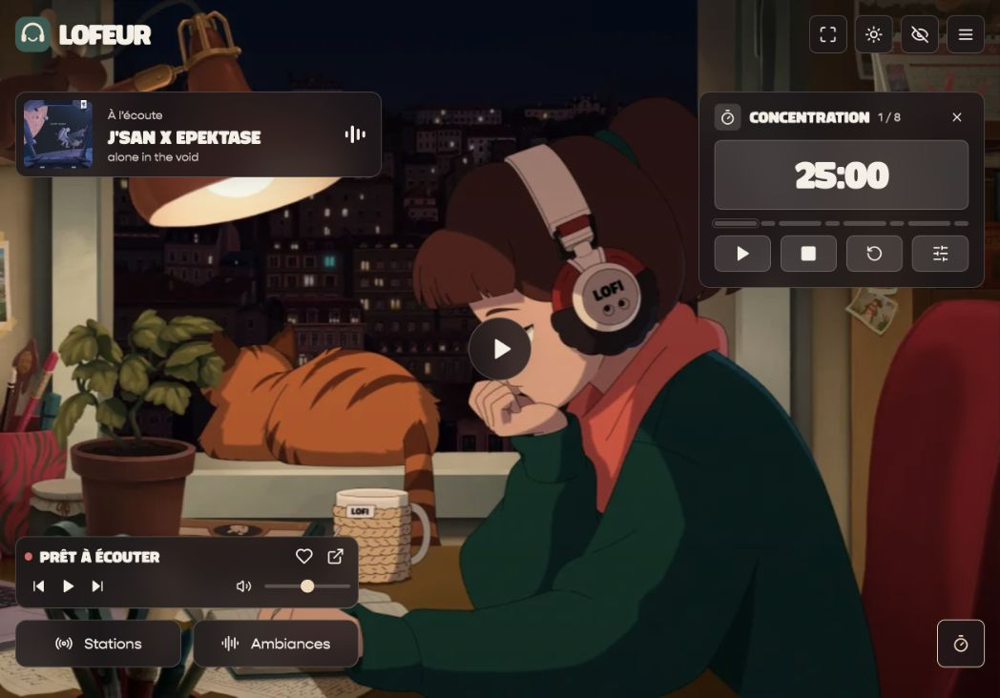
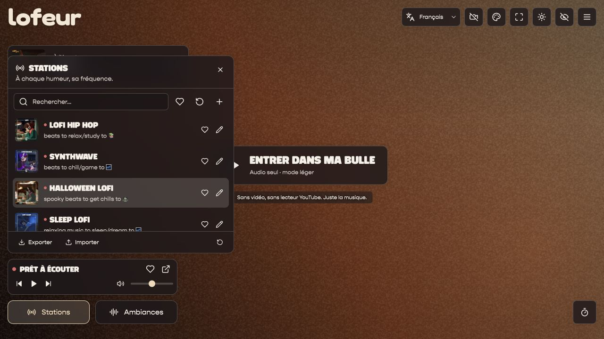
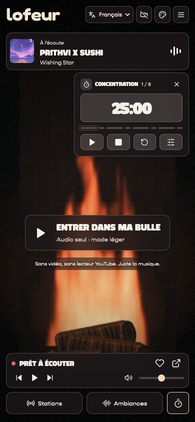
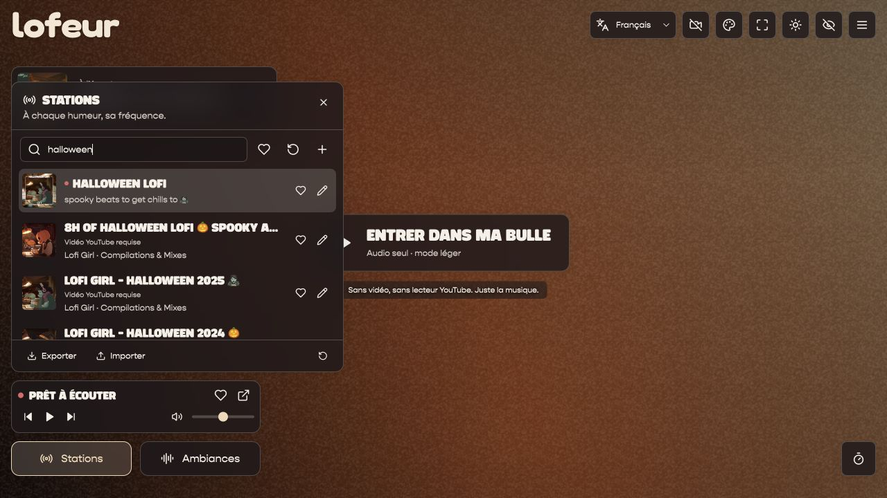

<p align="center">
  
</p>

<p align="center">
  
</p>

<h1 align="center">Your little corner of calm.</h1>

<p align="center">
  Lofi radio. Rain at the window. One thing at a time.<br />
  A personal lofi desk with editable YouTube stations, ambient soundscapes and a focus timer.
</p>

<p align="center">
  <a href="https://github.com/jean-voila/lofeur/actions/workflows/ci.yml"></a>
  
  
  
  <a href="LICENSE"></a>
</p>

<p align="center">
  <a href="https://jean-voila.github.io/lofeur/">Listen now</a> ·
  <a href="#a-desk-that-gets-out-of-your-way">Features</a> ·
  <a href="#make-yourself-at-home">Get started</a> ·
  <a href="#your-stations-your-rules">Custom stations</a> ·
  <a href="CONTRIBUTING.md">Contribute</a>
</p>

---

## A desk that gets out of your way

Inspired by [Lofi Desk](https://desk.lofigirl.com/), rebuilt around listening and
concentration. The familiar study scene and translucent controls, without account
gates, live chat, shopping widgets, announcements, notes or to-do lists.

| Tune in                                                | Set the mood                                           | Find your rhythm                                          |
| ------------------------------------------------------ | ------------------------------------------------------ | --------------------------------------------------------- |
| **18 live radios + 74 official mixes**                 | **12 original soundscapes**, mixed independently       | **Classic & long Pomodoro** with short and long breaks    |
| Add, edit and remove your own YouTube links            | Rain, beach, forest, fireplace, café, purring and more | Eight phases, pause, reset and adjustable alarm volume    |
| Favorites, search, previous / next and volume controls | Favorites, individual levels and a master volume       | Day / night theme, fullscreen and a hidden-interface view |

All preferences live in your browser. No API key, account or analytics service is required. Choose **French, English,
Spanish, Mandarin Chinese or Hindi** from the language selector.

## A little look inside

<p align="center">
  
</p>

<details>
<summary>Browse and edit your stations</summary>
<p align="center">
  
</p>
</details>

<details>
<summary>Made for small screens, too</summary>
<p align="center">
  
</p>
</details>

## Make yourself at home

**Node.js 22.12+ or 24+** and npm are all you need.

```bash
git clone https://github.com/jean-voila/lofeur.git
cd lofeur
npm ci
npm run dev
```

Open **http://127.0.0.1:5173** and press **Entrer dans ma bulle**. The default lightweight mode streams audio directly from Lofi Girl. Use the
camera button to enable YouTube video. Ambient sounds work independently.

```bash
npm test           # URL validation, station imports and timer recovery
npm run build      # TypeScript checks + production build
npm run preview    # Serve the production build locally
```

The site is **100% static and ready for GitHub Pages**. No application server is
needed by visitors. Run `npm run preview` to inspect the production files at
**http://127.0.0.1:4173/lofeur/**.

The [Pages workflow](.github/workflows/pages.yml) builds a validated artifact.
The public site is **[jean-voila.github.io/lofeur](https://jean-voila.github.io/lofeur/)**.
Pages publication is enabled with the repository variable `PAGES_ENABLED=true`.
See the [deployment guide](docs/github-pages.md) for the build and update lifecycle.

## Search-friendly by construction

Five prerendered language pages provide real HTML, localized titles and content,
canonical URLs, reciprocal language links, a sitemap and structured data.
The listening guide is available to people and crawlers alike. The language
selector updates the URL while preserving playback.

A mobile Lighthouse audit of the public GitHub Pages site measured **99 performance / 100 accessibility /
100 best practices / 100 SEO**. These scores are lab results, not ranking promises.
See [SEO implementation and publication steps](docs/seo.md).

## A lighter tab

- **Video off really unloads YouTube**, including its iframe and decoder. The 18
  radios use official public audio streams instead of a hidden video player.
- The procedural backdrop offers **aurora, flowing gradient, pixels and a
  fireplace**, with colors, grain, texture, intensity, speed and energy-saving
  controls. Animation pauses when the tab is hidden or reduced motion is enabled.
- Economy mode caps the main canvas's longest side at **480 pixels and 12 fps**;
  normal mode uses 720 pixels and 20 fps. No WebGL or full-resolution DPR buffers.
- Stopped sounds release their media sources and buffers. Station artwork loads
  lazily, and the list renders **24 rows at a time**.
- The Pomodoro ticks once per second. Metadata polling pauses in hidden tabs and
  avoids overlapping requests or redundant updates.

Recorded YouTube mixes need video playback unless you provide a separate direct
audio URL. lofeur does not extract audio from YouTube. The app explains this and
offers an enable-video action when needed.

## Stations that recover gracefully

Available live radios appear first, recordings next, and unavailable sources last.
A red dot identifies live content. Unavailable sources are grey and cannot be
started, while their edit controls remain available. Favorites reorder items
**within** these groups. Availability is specific to the chosen audio/video mode.

Playback failures update the list immediately. Temporary errors expire and can
be rechecked; bot challenges or failed verification requests are not treated as
proof that a station is unavailable. Use the refresh button to request a new check.

<p align="center"></p>

Availability is distributed as a static JSON snapshot and actual player errors
remain detectable in the browser. The refresh control rereads that published
snapshot; YouTube verification itself runs in GitHub Actions.

The scheduled [catalog workflow](.github/workflows/catalog.yml) runs every six
hours. It verifies the exact official [compilations playlist](https://www.youtube.com/playlist?list=PL6NdkXsPL07KN01gH2vucrHCEyyNmVEx4),
adds new recordings, checks playability, and repairs a broken default live URL
only when a unique matching live is found on the verified Lofi Girl channel.
It runs tests and builds before saving the updated catalog. User-edited sources
are preserved. External outages and regional restrictions can still occur.

```bash
npm run check:stations        # Refresh the health snapshot
node scripts/refresh-catalog.mjs  # Also sync and repair; requires yt-dlp
```

## Your stations, your rules

Open **Stations → +** to add a frequency. Set a name and paste a YouTube video or
live link. Descriptions and custom HTTPS cover images are optional. Use the pencil
icon to change or remove a station. At least one station is always kept.

Supported links include `youtube.com/watch?v=…`, `youtube.com/live/…`,
`youtu.be/…`, `youtube.com/embed/…` and plain 11-character video IDs.

**Exporter / Importer** transfers your station list as JSON. Import replaces the
current list; export a backup first if you want to keep it. Imports are validated,
limited to 250 entries and reject duplicate IDs. Use the reset button to restore
the original catalog, including the playlist.

```json
[
  {
    "id": "my-radio",
    "name": "Sunday radio",
    "url": "https://www.youtube.com/watch?v=rFZHOHl-L8A",
    "description": "A slower start to the day",
    "cover": ""
  }
]
```

Default stations live in [`src/stations.json`](src/stations.json). YouTube streams
can move or restrict embedding; change the URL or use the external YouTube link
when that happens. Only public station IDs from the reference catalog are included.

## A few quiet shortcuts

| Key      | Action                                          |
| -------- | ----------------------------------------------- |
| `Space`  | Play / pause radio                              |
| `F`      | Fullscreen                                      |
| `H`      | Hide / show interface                           |
| `M`      | Mute / unmute radio                             |
| `Escape` | Close panels or leave the hidden-interface view |

Shortcuts stay out of the way while typing or editing a station.

## Under the hood

**React 19 · TypeScript · Vite · Lucide · Vitest**

```text
src/
  assets/fonts/    Fingerprinted interface fonts
  App.tsx          Player, mixer, station editor and focus tools
  lib.ts           URL parsing, storage, audio catalog and timer math
  lib.test.ts      Behavioral tests
  station-health.ts Availability, grouping and catalog migrations
  ProceduralScene.tsx Bounded Canvas backdrop
  i18n.tsx         Five-language interface
  youtube.ts       Typed YouTube IFrame API loader
  now-playing.ts   Public live track metadata with backup
  stations.json    Public default station catalog
  style.css        Reference-inspired desktop and mobile styles
public/
  logo.svg         Fredoka wordmark, exported as vector paths
  social-preview.jpg Local Open Graph preview
docs/
  assets/          Banner and real browser previews
  reverse-engineering.md
```

The timer stores an absolute deadline and catches up after a suspended tab or
reload. Preferences persist locally; soundscapes intentionally wait for a user
action after a reload. Storage can be disabled by the browser, in which case the
app remains usable for the current visit.

## Credits & licensing

Music, stream animation, study artwork, radio covers and ambient recordings belong
to their respective creators, including **Lofi Girl**. Playback uses the official
YouTube player and the reference's public ambient URLs. YouTube can display its own
ads or promotions inside the streams.

lofeur is an independent project with no affiliation or endorsement. Original
application code is [MIT licensed](LICENSE). Third-party media and fonts are
**excluded** from that license. Review [`THIRD_PARTY.md`](THIRD_PARTY.md) before
public redistribution; the repository does not grant rights to third-party media or proprietary fonts.

The [reference notes](docs/reverse-engineering.md) describe what was observed and
the reconstruction's limits. The banner illustration is generated; its **lettering is real Fredoka typography**,
matching the SVG interface logo. The font, OFL license and rebuild scripts are
included in [`docs/branding/`](docs/branding/) and [`scripts/`](scripts/).
Application previews are real browser screenshots.

<p align="center"><sub>Put something good on. Take your time.</sub></p>
